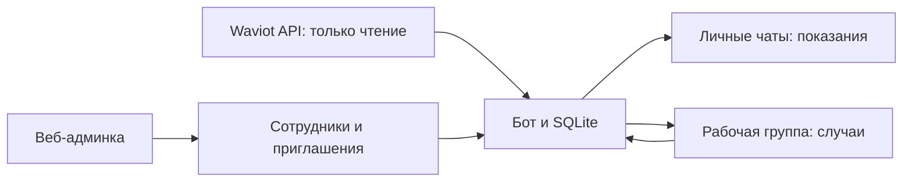

# Waviot → Telegram

Telegram-бот для сотрудников ТСЖ и управляющих организаций: показания счётчиков Waviot, общая очередь проверок и история действий сотрудников.

## Какую проблему решает

Газовый счётчик может перестать передавать данные или учитывать расход. Сотруднику нужно заметить подозрительную ситуацию, назначить проверку и сохранить её результат.

Целевой сценарий: в квартире есть расход воды или электричества, а газовый счётчик длительное время не показывает расход. Это основание для проверки. По данным API нельзя автоматически заключить, что села батарейка, счётчик сняли или произошла неисправность.

**Текущее состояние: автоматические тревоги выключены.** Проект уже позволяет получать показания, находить кандидатов по старой метке газового значения и вручную вести проверки. Автоматическое правило сопоставления расхода газа, воды и электричества ещё требует подтверждения контракта API и проверки на истории. Заявлять обнаружение вмешательства или готовый автоматический мониторинг пока нельзя.

## Что уже работает

- **Показания квартиры.** Сотрудник отправляет номер квартиры в личном чате и получает последние опубликованные показания газа, воды и электричества. Ответ содержит номер прибора, единицу, дату и предупреждение о старых данных. По электричеству показывается общий итог без отдельных тарифов.
- **Обход всего дома.** Сбор запускается при старте, каждые шесть часов и вручную. Запросы квартир последовательные, пауза — минимум одна секунда. Неполное дерево и сетевой сбой не заменяют принятый реестр частичными данными.
- **Кандидаты на проверку.** Отдельный список газовых значений с меткой старше 72 часов. Старая метка значения — наблюдение API, а не доказанный срок отсутствия радиосвязи или нулевого расхода.
- **Общая работа со случаями.** Карточки в одной Telegram-группе, назначение ответственного, пояснения, результаты проверки и история. Карточка содержит квартиру, корпус, номер газового счётчика, последнее показание и дату.
- **Разделение оснований.** Формат карточки поддерживает «Данные счётчика не поступают» и «Нет расхода» отдельно от результата проверки сотрудника. Автоматическое создание обоих видов тревог пока не включено.
- **Регистрация сотрудников.** Администратор добавляет имя и телефон, выдаёт одноразовый код на 24 часа. Сотрудник отправляет собственный контакт Telegram и код. Есть отключение доступа и перепривязка аккаунта через администратора.
- **Веб-админка.** Вход по логину и паролю, управление сотрудниками, подключение группы и журнал доступа. OTP для входа администратора не используется.
- **Сводки и напоминания.** Открытые проверки и случаи без ответственного; окно отправки — 09:00–18:00 по времени дома. Интерактивные ответы доступны круглосуточно.
- **Docker Compose.** Отдельные процессы бота и админки, SQLite в постоянном volume, healthchecks и дополнительная конфигурация Caddy для HTTPS на сервере.



## Быстрый запуск в Docker

Понадобятся Docker с Compose v2, Telegram-бот от BotFather и доступ к Waviot API нужного дома.

### 1. Настройте окружение

После скачивания проекта перейдите в его каталог:

```sh
cp .env.example .env
chmod 600 .env
mkdir -p artifacts
cp audit-scope.example.json audit-scope.json
```

Заполните локальный `.env`:

| Настройка | Назначение |
|---|---|
| `WAVIOT_API_KEY` | Ключ Waviot с доступом к нужному объекту |
| `WAVIOT_HOUSE_ID` | ID корневого узла дома, а не отдельной квартиры |
| `WAVIOT_HOUSE_LABEL` | Необязательное название дома в ответах |
| `TELEGRAM_BOT_TOKEN` | Токен бота от BotFather |
| `BOT_TIMEZONE` | Время дома, по умолчанию `Europe/Moscow` |
| `WAVIOT_REQUEST_INTERVAL_SECONDS` | Пауза запросов обхода; фактически не менее секунды |
| `BOT_LIVE_ALERTS` | Оставьте `false`: автоматические тревоги ещё недоступны |

В `audit-scope.json` укажите ID дома, **проверенное число квартир** в `accepted_apartment_count` и контрольные ID узлов из разных корпусов в `expected_node_ids`. Пример содержит условные значения; замените их по своему реестру. Без подтверждённого числа квартир полный обход не публикуется.

Никогда не добавляйте реальные `.env`, `audit-scope.json`, выгрузки или базы в Git. На одном Telegram-токене должен работать один polling-процесс.

### 2. Создайте администратора

```sh
docker compose build admin
docker compose run --rm --no-deps admin waviot-admin bootstrap
docker compose create admin
docker compose cp admin:/data/admin-onboarding.html artifacts/admin-onboarding.html
```

Откройте `artifacts/admin-onboarding.html` локально. В нём находятся логин `admin` и сгенерированный пароль. Сохраните пароль в менеджере паролей, затем удалите onboarding-файл с компьютера и из volume. Файл не нужен для дальнейшей работы; не публикуйте и не пересылайте его.

### 3. Передайте реестр и запустите сервисы

```sh
docker compose run --rm --no-deps -v "$PWD/audit-scope.json:/import/scope.json:ro" admin python -c "from shutil import copyfile; copyfile('/import/scope.json','/data/audit-scope.json')"
docker compose up -d --no-build admin bot
docker compose ps
```

Админка доступна на [http://127.0.0.1:8000](http://127.0.0.1:8000). Локальный порт привязан к localhost. Бот использует long polling, поэтому webhook и публичный порт для него не нужны.

### 4. Зарегистрируйте сотрудников и подключите группу

1. В админке добавьте сотрудника: имя и телефон. Передайте ему созданный код лично.
2. Сотрудник открывает личный чат с вашим ботом, отправляет `/start`, нажимает «Поделиться номером» и вводит код.
3. В админке создайте код подключения рабочей группы.
4. Зарегистрированный сотрудник, являющийся администратором этой группы, добавляет туда бота и отправляет `/connect КОД` от своего аккаунта.

Администратор веб-интерфейса также регистрируется как сотрудник, если собирается пользоваться ботом. Старый способ привязки личного чата через startup-ссылку не даёт доступа.

## Как пользоваться

| Где | Действие | Результат |
|---|---|---|
| Личный чат | `211` или `/flat 211` | Показания квартиры; номер здесь — условный пример |
| Рабочая группа | `/candidates` | Кандидаты по старым меткам газовых значений |
| Рабочая группа | Кнопка «Проверить» у кандидата | Ручное создание случая |
| Рабочая группа | `/cases` | Открытые случаи |
| Карточка случая | «Взять в работу» | Назначение ответственного |
| Карточка случая | Кнопка результата и ответ на приглашение | Сохранение результата и пояснения |
| Рабочая группа | `/history ID` или «История» | Кто, когда и что сделал |
| Бот | `/house`, `/status`, `/scan` | Покрытие реестра, состояние и ручной сбор |
| Рабочая группа | `/demo` | Явно вымышленный случай для обучения |
| Бот | `/help` | Команды и ограничения |

«Неисправность» и «Причина неизвестна» оставляют случай открытым. «Нормальная ситуация» закрывает его. «Устранено» доступно после подтверждения неисправности. Результаты сохраняются с пояснением и автором. Все участники рабочей группы видят её сообщения; состав группы контролирует её администратор.

Даты показаний и карточек выводятся в GMT+3 без подписи часового пояса. Это накопленные показания счётчиков, а не расход за выбранный период. Пропуски остаются неизвестными и не заменяются нулями.

## Сервер, обновления и резервные копии

[Подробная инструкция](docs/deployment.md) описывает перенос существующей базы, восстановление доступа, остановку, резервные копии и публичный HTTPS-адрес.

Для сервера предусмотрен `compose.public.yaml`: Caddy, домен, HTTPS и secure cookies. Сначала создайте администратора, настройте DNS и `ADMIN_DOMAIN`, затем запускайте публичную конфигурацию. Реальный домен и получение сертификата проверяются при серверном развёртывании.

```sh
docker compose stop bot admin
docker compose start bot admin
```

Данные находятся в volume `waviot_runtime`. Для полной согласованной копии остановите оба сервиса и сохраните volume целиком. `docker compose down` сохраняет данные; `docker compose down -v` их удаляет. Для контейнера не используйте команду `waviot-bot stop` с хоста: PID принадлежит другому namespace.

## Разработка и проверка

Вариант без установки Python на хост:

```sh
docker compose --profile test build tests
docker compose --profile test run --rm --no-deps tests
```

Тестовый сервис не получает реальные ключи, не имеет сети и использует синтетические данные.

Для разработки локально нужен Python 3.13 или новее:

```sh
python3.13 -m venv .venv
.venv/bin/pip install -r requirements-dev.lock
.venv/bin/pip install --no-build-isolation --no-deps .
.venv/bin/python -m pytest -q
```

После изменения исходников переустановите пакет. Дополнительный CLI `waviot-audit` выполняет чтение API и сохраняет приватные отчёты; его назначение — проверка контракта интеграции, а не автоматическая диагностика.

## Безопасность и границы проекта

- Бот читает Waviot и не отправляет команды управления приборами.
- Запросы квартиры доступны зарегистрированным сотрудникам, действия по случаям — в подключённой группе. Доступ проверяется также перед отложенной личной отправкой.
- Пароль администратора хранится средствами Django, приглашения — как хеши. Есть CSRF-защита, проверка origin, ограничения попыток входа и регистрации, экранирование динамических полей.
- Секреты, SQLite, реальные адреса, телефоны сотрудников, ID объектов и диагностические выгрузки должны оставаться вне публичного репозитория и Docker build context.
- В примерах и тестах используются вымышленные данные. Реестр, настройки и исходные документы конкретной эксплуатации не входят в эту публикацию.
- Отсутствие расхода само по себе не доказывает неисправность или вмешательство. Автоматическая корреляция ресурсов и подтверждение причин пока не реализованы для рабочего мониторинга.

Подробности защиты данных и повторной проверки перед публикацией: [SECURITY.md](SECURITY.md).
